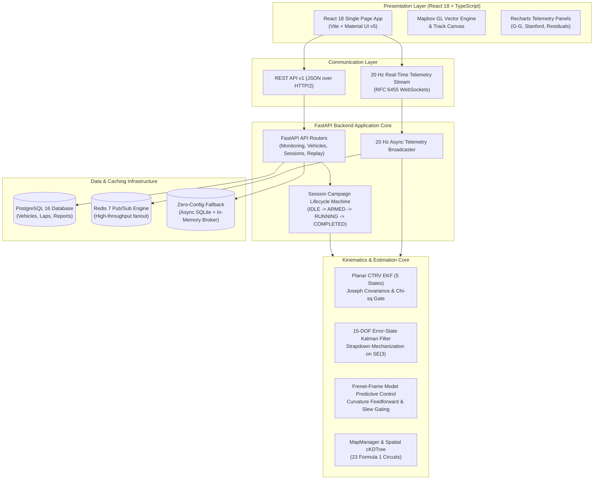

# Enterprise Platform Architecture

ApexPathAI is structured as an enterprise-grade Autonomous Vehicle (AV) Proving Ground Validation & State Estimation Platform. The platform decouples presentation, high-speed telemetry streaming, state estimation algorithms, and persistent storage.

---

## High-Level Topology

---

## 1. Frontend Architecture (`frontend/`)

- **Modern Stack:** React 18, TypeScript, Vite, Material UI (MUI v5), Mapbox GL, Recharts.
- **Dark Cockpit Aesthetic:** Specially crafted dark aeronautic color scheme (`#0B0F19` void background, `#00E5FF` electric cyan, `#00E676` telemetry green, `#FF3D71` emergency stop).
- **10 Modular Screen Views:**
  1. `LiveCockpit`: Real-time 20 Hz instrument cluster with G-force display, speed gauge, and Stanford error plane.
  2. `VehicleCatalog`: Fleet management and physical parameter tuning.
  3. `CircuitList`: Interactive 23-track gallery with downsampled centerline previews.
  4. `SessionManager`: Test campaign execution, sector split times, and state transitions.
  5. `LocalizationAnalytics`: CEP50, CEP95, HPL, and NEES consistency charts.
  6. `VehicleAnalytics`: Tire sideslip angle ($\beta$), curvature, and acceleration envelope.
  7. `SensorDiagnostics`: Live innovation residuals (NIS) and fault injection buttons.
  8. `ReplayScrubber`: Incident scrubber with interactive seek bar and playback rate controls.
  9. `KPIScorecardTable`: Automated pass/fail matrix against ISO 21448 thresholds.
  10. `ReportGenerator`: Formal validation dossier compiler with Markdown and JSON exports.

---

## 2. Backend Application Core (`backend/app/`)

- **Application Factory:** Configured with FastAPI lifespan managers for clean startup and asynchronous shutdown.
- **Pydantic v2 Contracts:** Strict data validation models ensuring deterministic API payloads across all endpoints.
- **Dual Database Strategy:**
  - **Production:** Async SQLAlchemy with asyncpg connecting to PostgreSQL 16.
  - **Zero-Config Developer Onboarding:** Automatic fallback to SQLite (`sqlite+aiosqlite`) when running standalone without external Docker containers.
- **Pub/Sub Telemetry Broker:**
  - Redis 7 pub/sub for high-throughput distributed fanout.
  - In-memory event broker fallback for single-instance development.

---

## 3. Autonomous Kinematics & Estimation Core (`Localization/core/`)

- **Dual-Stack Fusion:**
  - **Planar CTRV EKF:** 5-state vector $[p_x, p_y, \theta, v, \omega]^T$ tracking high-speed planar motion on $S^1$ manifold.
  - **15-DOF ESKF:** 3D strapdown inertial navigation on $\text{SE}(3) \times \mathbb{R}^6$ with unit quaternion error propagation.
- **Frenet Model Predictive Guidance:**
  - Coordinates tracking against precomputed optimal racelines.
  - Cross-track error ($e_y$) and heading alignment ($e_\psi$) calculations.
