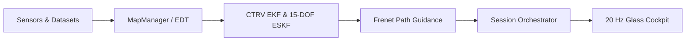

# Welcome to ApexPathAI

ApexPathAI is an open-source autonomous vehicle localization, state estimation, and proving ground validation platform. It integrates state estimation theory with real-time telemetry streaming and automated safety verification on closed-circuit proving grounds.

## Key Capabilities

1. **Dual State Estimation Stacks:**
   - **5-State Planar CTRV EKF:** Real-time localization with exact circular-arc integration, continuous-to-discrete process noise projection, manifold angle wrapping on $S^1$, and Joseph-stabilized covariance updates.
   - **15-DOF Error-State Kalman Filter:** High-rate strapdown inertial mechanization on $\text{SE}(3) \times \mathbb{R}^6$ with unit quaternion orientation on $\text{SO}(3)$ and online accelerometer/gyroscope bias tracking.
2. **Proving Ground Automated Validation:**
   - Automated 7-rule KPI scorecard verifying position accuracy, lateral deviation, geofence clearance, horizontal protection level (HPL), NEES filter consistency, MPC determinism, and disengagements.
3. **Deterministic Fault Injection:**
   - Proving-ground scenario execution simulating tunnel GNSS blackouts, urban canyon multipath reflections, and camera glare blinding.
4. **Interactive Glass-Cockpit Dashboard:**
   - 8-screen engineering interface exposing high-frequency telemetry via WebSockets and REST APIs at 20 Hz.
