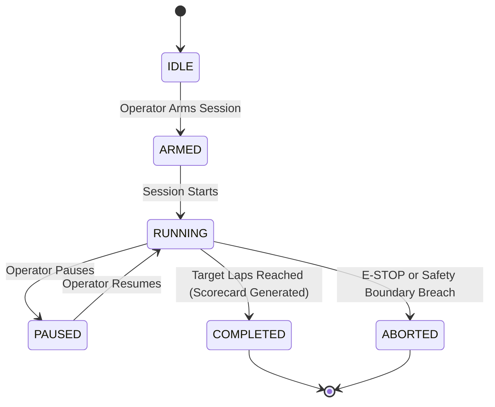

# Automated 7-Rule KPI Scorecard

ApexPathAI evaluates closed-loop test sessions against 7 automated validation rules inspired by ISO 21448 (Safety of the Intended Functionality - SOTIF) and autonomous racing integrity standards.

---

## The 7 Regulatory Rules

| Rule | Metric Name | Threshold | Failure Condition | Target Standard |
| :--- | :--- | :--- | :--- | :--- |
| **Rule 1** | 2D Position Accuracy (RMSE) | $\le 0.35\,\text{m}$ | Filter divergence or excessive drift | Lane-keeping accuracy |
| **Rule 2** | Lateral Tracking Error ($e_y$) | $\le 0.60\,\text{m}$ | Vehicle oscillates or cuts corners | Dynamic stability |
| **Rule 3** | Geofence Boundary Margin | $\ge 0.50\,\text{m}$ | Proximity violation with track walls | Collision prevention |
| **Rule 4** | Horizontal Protection Level (HPL) | $\le 3.00\,\text{m}$ | Integrity risk exceeds $10^{-7}$ | Safety integrity monitoring |
| **Rule 5** | Normalized Estimation Error (NEES) | $[2.0, 5.5]$ | Filter over-confident or under-confident | Kalman statistical consistency |
| **Rule 6** | Real-Time Execution Latency | $\le 5.0\,\text{ms}$ | Solver overrun or deadline miss | Real-time determinism |
| **Rule 7** | Operator Disengagements | $= 0$ | Safety disengagement triggered | Autonomous mission success |

---

## Scorecard Lifecycle & State Machine

### Overall Session Verdict
A test session achieves an **OVERALL PASS** if and only if:
1. The session is not aborted (no E-STOP or operator termination).
2. All 7 regulatory rules simultaneously achieve `passed == True`.
3. All target laps are successfully completed.
